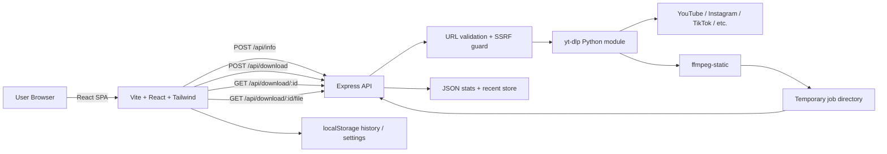
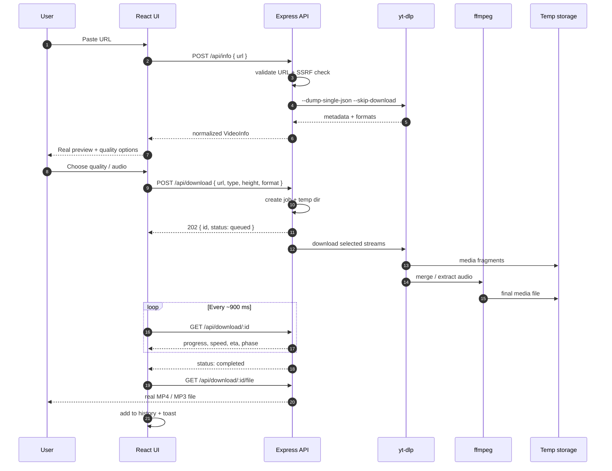

# VidPlex — Premium Video Downloader

> A production-style, dark-first video downloader for YouTube, Instagram, Facebook, TikTok, X (Twitter), Vimeo, Twitch, Dailymotion, Reddit, and direct media URLs.

VidPlex is not a mock UI. It is a full-stack application that reads **real video metadata** with `yt-dlp`, downloads the **actual media file**, merges video + audio with `ffmpeg`, streams the finished file back to the browser, and tracks progress in real time.

---

## Table of Contents

- [1. Product Overview](#1-product-overview)
- [2. Core Features](#2-core-features)
- [3. Screens and User Experience](#3-screens-and-user-experience)
- [4. System Architecture](#4-system-architecture)
- [5. Tech Stack](#5-tech-stack)
- [6. Repository Structure](#6-repository-structure)
- [7. Frontend Architecture](#7-frontend-architecture)
- [8. Backend Architecture](#8-backend-architecture)
- [9. Download Workflow](#9-download-workflow)
- [10. API Reference](#10-api-reference)
- [11. Data Models](#11-data-models)
- [12. Configuration and Environment Variables](#12-configuration-and-environment-variables)
- [13. Getting Started](#13-getting-started)
- [14. Build and Production](#14-build-and-production)
- [15. Testing and Verification](#15-testing-and-verification)
- [16. Security and Privacy](#16-security-and-privacy)
- [17. Performance and Reliability](#17-performance-and-reliability)
- [18. Troubleshooting](#18-troubleshooting)
- [19. Limitations and Roadmap](#19-limitations-and-roadmap)
- [20. Legal Notice](#20-legal-notice)

---

## 1. Product Overview

### What it is

VidPlex is a premium, SaaS-style web application for downloading public videos and extracting audio. The interface follows a modern dark design language inspired by Apple, Stripe, Linear, and Vercel: deep navy surfaces, violet-to-cyan gradients, glassmorphism, soft borders, animated ambient blobs, and restrained motion.

### The problem it solves

Most "video downloader" demos are front-end theatre:

- They show a fake video preview.
- Quality buttons are hard-coded.
- Clicking download creates a 4-byte text blob named `.mp4`.
- Nothing is actually downloaded.

VidPlex replaces that with a real pipeline:

1. Validate the URL and block private-network targets.
2. Ask `yt-dlp` for real metadata and available formats.
3. Display the real thumbnail, title, duration, channel, and quality list.
4. Start a background download job.
5. Merge the best video stream with the best audio stream using `ffmpeg`.
6. Poll real progress from the server.
7. Stream the finished MP4 / MP3 / M4A file to the browser.
8. Save the download to local history and analytics.

### Product principles

| Principle | How it is applied |
| --- | --- |
| Real over fake | Every file, thumbnail, title, and quality comes from the source or the actual job. |
| Premium by default | Dark-only design system, glass panels, gradient accents, polished empty states. |
| Fast feedback | Skeleton loading, optimistic UI states, live progress, toasts. |
| Private by design | No account required, history stored locally, temporary files auto-deleted. |
| Mobile first | Every page is responsive from 320 px to ultra-wide. |
| Calm complexity | Advanced behavior (jobs, polling, merging) is hidden behind a simple paste-and-go UI. |

---

## 2. Core Features

### Downloader

- Real metadata extraction from public URLs.
- Real MP4 download with video + audio merged by `ffmpeg`.
- Real MP3 / M4A audio extraction.
- Quality options generated from the source, including 360p, 480p, 720p, 1080p, 2K, and 4K when available.
- Unavailable qualities are visibly disabled instead of pretending to work.
- Live progress with percentage, phase, speed, and ETA.
- Cancel, retry, and re-download actions.
- Direct media URL fallback for plain `.mp4`, `.webm`, `.mp3`, `.m4a`, and similar links.
- Automatic browser save when a job completes.

### Library and dashboard

- Local download history with search, media-type filter, and sorting.
- Favorites that survive history clears.
- Analytics: total downloads, total bytes, average file size, top platform, platform distribution, video/audio split, and last 7 days.
- Usage overview and storage indicator.
- Account/profile settings stored on the device.
- Export library as JSON.
- Clear history or reset the workspace with confirmation modals.
- Backend health panel showing API, `yt-dlp`, and `ffmpeg` status.

### Marketing site

- Hero headline: **Download Videos From Any Platform**.
- Large URL input with paste support.
- Platform badges and marquee.
- Animated statistics counters.
- Six feature cards:
  - Ultra Fast Downloads
  - Secure Processing
  - HD & 4K Support
  - Audio Extraction
  - No Registration
  - Multi Platform Support
- "How it works" steps.
- Recent downloads table with live server activity.
- FAQ accordion.
- Final call-to-action section.

### Design system

- Inter typeface with strong hierarchy.
- Color tokens: `#6D28D9`, `#7C3AED`, `#06B6D4`, `#3B82F6`, `#0F172A`, `#020617`.
- Animated gradient blobs, floating particles, grid and noise overlays.
- Glassmorphism cards with inset highlights.
- Magnetic buttons with spring motion.
- Framer Motion fade, slide, scale, layout, and stagger transitions.
- Loading skeletons for metadata and preview states.
- Toast notifications, dropdowns, switches, badges, modals, and confirm dialogs.

---

## 3. Screens and User Experience

### Routes

| Route | Page | Purpose |
| --- | --- | --- |
| `/` | Home | Marketing site + real downloader |
| `/dashboard` | Dashboard | History, favorites, analytics, settings |
| `*` | Not Found | Friendly 404 with return action |

### Home page composition

```text
Navbar
  Hero
    Headline + subheading + social proof
    Downloader (URL input, preview, quality, progress)
  PlatformMarquee
  Stats
  Features
  HowItWorks
  RecentDownloads
  FAQ
  CTA
Footer
```

### Downloader states

The downloader is a small state machine:

```text
idle
  └─ fetchInfo() ──► fetching
                       ├─ success ──► ready
                       └─ failure ──► error

ready
  └─ start() ──► starting ──► downloading ──► processing ──► completed
                                   └──────── failure ───────► error

completed ──► redownload() / new download
error     ──► retry()
```

Each state has dedicated UI:

| State | UI |
| --- | --- |
| `idle` | Empty state with three-step guide |
| `fetching` | Skeleton preview and "Analyzing…" button |
| `ready` | Real thumbnail, title, channel, duration, formats |
| `starting` | Progress panel, "Starting secure download" |
| `downloading` | Progress bar, speed, ETA, cancel |
| `processing` | "Processing media" with indeterminate-looking progress |
| `completed` | Success card, file size, save again, new download |
| `error` | Human-readable error, retry, dismiss |

### Dashboard tabs

| Tab | Contents |
| --- | --- |
| Overview | Stat cards, 7-day activity chart, usage, quick actions, recent activity |
| History | Searchable and sortable table with favorite/remove/reuse actions |
| Favorites | Visual cards for saved downloads |
| Analytics | Platform distribution, quality breakdown, media composition |
| Settings | Profile, defaults, behavior switches, appearance, data controls |

---

## 4. System Architecture

### High-level architecture



### Runtime modes

**Development**

```text
Browser → Vite dev server :5173
             ├─ serves React with HMR
             └─ proxies /api → Express :5000
```

**Production**

```text
Browser → Express :5000
             ├─ serves /dist static build
             ├─ serves SPA fallback to index.html
             └─ serves /api endpoints
```

### Request lifecycle

1. The browser sends a URL to `POST /api/info`.
2. The server validates the URL and resolves the hostname to block private IPs.
3. `yt-dlp --dump-single-json` extracts metadata.
4. The server normalizes formats into a simple `heights[]` + `formats[]` shape.
5. The frontend renders the real preview and quality options.
6. `POST /api/download` creates a job and returns `202` immediately.
7. `yt-dlp` downloads the selected streams; `ffmpeg` merges or extracts audio.
8. The frontend polls `GET /api/download/:id` every ~900 ms.
9. On completion, the frontend triggers `GET /api/download/:id/file`.
10. Express streams the file with the correct MIME type and filename.
11. The download is recorded in the server stats store and the local history.
12. Temporary files are deleted after download or after the TTL expires.

---

## 5. Tech Stack

### Frontend

| Layer | Technology | Why |
| --- | --- | --- |
| UI library | React 19 | Modern component model and concurrent rendering |
| Language | TypeScript | Type-safe API contracts and components |
| Build tool | Vite 8 | Fast HMR and optimized production builds |
| Styling | Tailwind CSS 3.4 | Token-driven utility styling |
| Animation | Framer Motion 14 | Layout, spring, stagger, and gesture animations |
| Icons | Lucide React + React Icons | Consistent iconography and brand marks |
| Routing | React Router 7 | SPA routes and hash-aware navigation |
| Notifications | React Hot Toast | Premium toast system |
| Utilities | clsx + tailwind-merge | Safe conditional class composition |

### Backend

| Layer | Technology | Why |
| --- | --- | --- |
| Runtime | Node.js | Same language as frontend, strong streaming support |
| Server | Express 5 | Small, predictable HTTP layer |
| Media extraction | `yt-dlp` (Python module) | Best-in-class support for thousands of sites |
| Media processing | `ffmpeg-static` | Bundled FFmpeg binary, no system install required |
| Validation | Node `dns`, `net`, `URL` | SSRF and protocol protection |
| Storage | JSON file + in-memory maps | Zero external database for a single-node deployment |
| Process control | `child_process.spawn` | Streaming progress and cancellable jobs |

### Design and tooling

| Tool | Purpose |
| --- | --- |
| Inter | Primary typeface |
| PostCSS + Autoprefixer | CSS pipeline |
| Oxlint | Fast linting |
| TypeScript project references | Strict app/node builds |
| concurrently | Runs API and Vite together in development |

---

## 6. Repository Structure

```text
videoDownloader/
├─ index.html                     # SPA shell, fonts, metadata
├─ package.json                   # Scripts and dependencies
├─ vite.config.ts                 # Dev/preview API proxy
├─ tailwind.config.js             # Design tokens and keyframes
├─ postcss.config.js
├─ tsconfig*.json
├─ README.md                      # This document
│
├─ public/                        # Static assets
│
├─ server/
│  ├─ index.js                    # Express app and API routes
│  ├─ data/
│  │  └─ store.json               # Persisted stats and recent downloads
│  └─ lib/
│     ├─ jobs.js                  # Download job manager, progress, cleanup
│     ├─ security.js              # URL validation, SSRF guard, rate limit
│     ├─ store.js                 # Stats/recent persistence and seed data
│     └─ ytdlp.js                 # yt-dlp invocation and metadata normalization
│
└─ src/
   ├─ main.tsx                    # React entry point
   ├─ App.tsx                     # Router, providers, 404
   │
   ├─ pages/
   │  ├─ Home.tsx                 # Marketing + downloader composition
   │  └─ Dashboard.tsx            # Library, analytics, settings
   │
   ├─ components/
   │  ├─ background/Ambient.tsx   # Blobs, particles, grid, noise
   │  ├─ dashboard/               # StatCard, ActivityChart, HistoryTable, UpgradeModal
   │  ├─ home/                    # Hero, Downloader, Stats, Features, FAQ, CTA, etc.
   │  ├─ layout/                  # Navbar, Footer, Layout, Logo, AuthModal
   │  └─ ui/                      # Button, GlassCard, Modal, Dropdown, Badge, etc.
   │
   ├─ hooks/
   │  └─ useDownloader.ts         # Real analyze/start/poll/cancel/retry logic
   │
   ├─ lib/
   │  ├─ api.ts                   # Typed fetch client
   │  ├─ events.ts                # Cross-component analyze event bus
   │  ├─ format.ts                # Formatting and class utilities
   │  ├─ store.tsx                # History/favorites/settings/analytics context
   │  └─ types.ts                 # Shared TypeScript contracts
   │
   └─ styles/
      └─ index.css                # Global design system and utilities
```

---

## 7. Frontend Architecture

### Routing

`src/App.tsx` wraps the app in `StoreProvider` and `BrowserRouter`, then renders a shared `Layout` with an `<Outlet />`.

- `/` → `Home`
- `/dashboard` → `Dashboard`
- `*` → inline `NotFound`

### State management

VidPlex intentionally avoids a heavy global state library.

| State | Owner | Persistence |
| --- | --- | --- |
| Download job state | `useDownloader` hook | Server (job map) |
| History, favorites, settings, analytics | `StoreProvider` context | `localStorage` |
| Profile | `Dashboard` component | `localStorage` |
| Server stats and recent feed | Express store | `server/data/store.json` |
| UI-only state (modals, tabs, search) | Local component state | None |

`StoreProvider` exposes:

```ts
history
favorites
settings
analytics
addHistory(item)
updateHistory(id, patch)
removeHistory(id)
clearHistory()
toggleFavorite(id)
updateSettings(patch)
resetAll()
```

### `useDownloader` hook

The hook is the bridge between UI and backend.

Responsibilities:

- Validate URL shape on the client.
- Call `POST /api/info`.
- Manage `stage`, `info`, `job`, `error`, and `sourceUrl`.
- Start a download job.
- Poll job status with retry/backoff.
- Detect completion and add history.
- Trigger the browser download automatically.
- Support cancel, retry, reset, and re-download.

Important refs:

- `requestId` prevents stale responses from overwriting newer ones.
- `pollTimer` prevents overlapping polls.
- `lastParams` enables retry without re-analyzing.
- `completedJob` prevents duplicate history entries and duplicate toasts.

### Component highlights

| Component | Responsibility |
| --- | --- |
| `Hero` | Headline, social proof, floating product cards, downloader mount |
| `Downloader` | URL form, preview, media type, quality, audio, progress |
| `PlatformMarquee` | Infinite brand marquee |
| `Stats` | Animated counters backed by `/api/stats` |
| `Features` | Six premium feature cards |
| `HowItWorks` | Three-step workflow |
| `RecentDownloads` | Live recent feed + local history preview |
| `Faq` | Animated accordion |
| `Cta` | Final conversion section |
| `Navbar` | Scroll-aware glass navigation, health indicator, mobile menu |
| `Footer` | Product/resource/company links |
| `Button` | Magnetic spring button with variants |
| `GlassCard` | Pointer-reactive glass surface |
| `Dropdown` | Accessible custom select |
| `Modal` / `ConfirmModal` | Animated dialogs |
| `Skeleton` | Preview and card loading states |
| `Counter` | Viewport-triggered animated number |
| `PlatformIcon` | Brand icon with platform color |

### Design system

Defined in `src/styles/index.css` and `tailwind.config.js`.

**Core colors**

```text
#020617  page background
#0F172A  surface
#6D28D9  deep violet
#7C3AED  primary violet
#3B82F6  electric blue
#06B6D4  cyan accent
```

**Surfaces**

- `bg-white/[0.02]` to `bg-white/[0.08]` layers.
- 1 px translucent borders.
- Inset top highlight for a glass edge.
- Large soft shadows instead of harsh borders.
- `backdrop-blur-xl` / `backdrop-blur-2xl` for depth.

**Motion**

- Page/section entrance: fade + translate + spring easing.
- Buttons: magnetic pointer offset and tap scale.
- Cards: subtle hover lift and border glow.
- Progress: animated gradient with shimmer.
- Ambient: slow floating blobs and particles.
- Respect for reduced motion is handled through restrained durations and transform-only effects.

**Responsive strategy**

- Mobile-first Tailwind breakpoints.
- Sidebar becomes horizontal scroll tabs on mobile.
- Downloader form stacks vertically below `sm`.
- Preview switches from stacked to two-column at `lg`.
- Quality grid: 3 columns mobile, 6 columns desktop.
- Typography scales from `text-[42px]` to `text-[76px]` on the hero.

---

## 8. Backend Architecture

### Express server

`server/index.js` is the entry point.

Responsibilities:

- CORS configuration.
- JSON body parsing with a 32 KB limit.
- Security headers.
- Rate limiting.
- URL validation.
- Info extraction and caching.
- Download job creation and polling.
- File streaming.
- Static production build serving.
- SPA fallback.
- Graceful shutdown.

### Middleware and headers

```text
X-Content-Type-Options: nosniff
Referrer-Policy: no-referrer
X-Frame-Options: SAMEORIGIN
```

CORS defaults to `*` for local development and can be restricted with `PUBLIC_ORIGIN`.

### Info cache

- In-memory `Map`.
- TTL: 10 minutes.
- Maximum 200 entries.
- Oldest entry evicted when full.
- Cached responses include `cached: true`.

### Rate limits

| Endpoint | Window | Max requests |
| --- | --- | --- |
| `POST /api/info` | 60 s | 30 |
| `POST /api/download` | 60 s | 12 |

Rate limiting is per IP using a sliding window. Exceeded requests receive `429` with `Retry-After`.

### Job manager

`server/lib/jobs.js` owns the download lifecycle.

Key design:

- Jobs live in an in-memory `Map`.
- Each job gets a UUID and its own temp directory under `os.tmpdir()/vidplex-jobs/<id>`.
- Maximum concurrent jobs: `MAX_CONCURRENT_DOWNLOADS` (default `3`).
- Job max age: 45 minutes.
- File TTL after download: 30 minutes.
- Cleanup runs every 10 minutes and on shutdown.
- Cancellation kills the whole process tree (Windows: `taskkill /T /F`).

### Format selection

For video:

```text
bv*[height<=H][ext=mp4]+ba[ext=m4a]
bv*[height<=H]+ba
b[height<=H]
bv*[height<=H]
bv*+ba/b
```

This prefers MP4 video plus M4A audio, then falls back to any best stream. Output is merged and remuxed to MP4.

For audio:

```text
-f ba/b -x --audio-format mp3|m4a --audio-quality 0
```

### Progress model

`yt-dlp` progress is parsed from `--newline --progress-template`.

The UI maps progress into a human-friendly range:

| Phase | Progress range |
| --- | --- |
| First stream download | 0–78% |
| Second stream download | 78–96% |
| Merge / extract / metadata | 92–99% |
| Completed | 100% |

Direct URL downloads use byte counters and `Content-Length` to estimate progress, speed, and ETA.

### Output discovery

After the process exits, the server scans the job directory for the largest valid media file:

```text
media.mp4 | media.webm | media.mkv | media.mov
media.mp3 | media.m4a | media.opus | media.ogg | media.wav
```

Partial files (`.part`, `.ytdl`, `.temp`) are ignored.

### File serving

`GET /api/download/:id/file`:

- Requires a completed job with an existing file.
- Sets `Content-Type` based on format:
  - `mp3` → `audio/mpeg`
  - `m4a` → `audio/mp4`
  - otherwise → `video/mp4`
- Sets `Content-Length` and `Cache-Control: no-store`.
- Uses `res.download()` to send the file with a sanitized filename.
- Schedules file cleanup after transfer.

### Direct URL fallback

If `yt-dlp` fails and the URL looks like a direct media file, the server:

1. Tries `HEAD`.
2. Falls back to a ranged `GET`.
3. Reads `Content-Type` and `Content-Length`.
4. Builds metadata manually.
5. Streams the file directly with `fetch` + `pipeline`.

### Persistence

`server/lib/store.js` keeps:

- Baseline marketing stats.
- Real download count and bytes.
- Rolling speed samples.
- Recent download feed.

It writes atomically to `server/data/store.json` using a temp file + rename, debounced by 400 ms.

---

## 9. Download Workflow



### User-facing flow

1. Paste a link or use the Paste button.
2. The app shows a skeleton while analyzing.
3. Real metadata appears.
4. Choose MP4 or MP3.
5. Choose an available quality or bitrate.
6. Click **Start download**.
7. Watch real progress.
8. The file saves automatically when ready.
9. Use **Save file** to download again.
10. Open the dashboard to see history and analytics.

---

## 10. API Reference

Base URL in development: `http://127.0.0.1:5000`

The frontend calls relative `/api` paths, proxied by Vite.

### `GET /api/health`

Returns service and dependency health.

```json
{
  "status": "operational",
  "checks": {
    "server": true,
    "ffmpeg": true,
    "ytdlp": true,
    "version": "2026.10.26"
  },
  "uptime": 128,
  "activeJobs": 0,
  "timestamp": 1793506888056
}
```

Status codes: `200` healthy, `503` degraded.

### `GET /api/stats`

Returns marketing and real usage stats.

```json
{
  "totalDownloads": 12480392,
  "activeUsers": 2184507,
  "platforms": 24,
  "avgSpeedMbps": 48,
  "realDownloads": 0,
  "realBytes": 0,
  "last24h": 18204,
  "activeJobs": 0,
  "uptime": 128
}
```

### `GET /api/recent?limit=12`

Returns recent downloads from the server store.

```json
{
  "items": [
    {
      "id": "dl_1793500000000_ab12c",
      "title": "Example video",
      "thumbnail": "https://...",
      "platform": "YouTube",
      "quality": "1080p",
      "format": "mp4",
      "sizeBytes": 48234496,
      "status": "completed",
      "createdAt": 1793500000000,
      "sample": false
    }
  ]
}
```

### `POST /api/info`

Analyzes a URL and returns normalized metadata.

**Request**

```json
{
  "url": "https://www.youtube.com/watch?v=jNQXAC9IVRw"
}
```

**Response**

```json
{
  "id": "jNQXAC9IVRw",
  "url": "https://www.youtube.com/watch?v=jNQXAC9IVRw",
  "title": "Me at the zoo",
  "description": "",
  "thumbnail": "https://i.ytimg.com/vi/jNQXAC9IVRw/hqdefault.jpg",
  "platform": "YouTube",
  "channel": "jawed",
  "channelUrl": "https://www.youtube.com/@jawed",
  "duration": 19,
  "durationLabel": "0:19",
  "viewCount": 447378614,
  "uploadDate": "20050423",
  "isLive": false,
  "formats": [
    {
      "formatId": "18",
      "height": 240,
      "quality": "240p",
      "ext": "mp4",
      "fps": 25,
      "codec": "avc1.42001E",
      "filesize": 609452,
      "hasAudio": true
    }
  ],
  "heights": [240, 144],
  "audioFormats": [
    { "format": "mp3", "quality": "320 kbps", "bitrate": 320, "filesize": 760000 },
    { "format": "mp3", "quality": "192 kbps", "bitrate": 192, "filesize": 456000 },
    { "format": "m4a", "quality": "256 kbps", "bitrate": 256, "filesize": 608000 }
  ],
  "extractor": "Youtube",
  "cached": true
}
```

**Errors**

| Status | Code | Meaning |
| --- | --- | --- |
| 400 | `invalid_url` | Missing, malformed, or unsafe URL |
| 422 | `extract_failed` | Platform unsupported, private, or extraction failed |
| 429 | `rate_limited` | Too many analysis requests |

### `POST /api/download`

Creates a download job and returns immediately.

**Request**

```json
{
  "url": "https://www.youtube.com/watch?v=jNQXAC9IVRw",
  "title": "Me at the zoo",
  "thumbnail": "https://i.ytimg.com/vi/jNQXAC9IVRw/hqdefault.jpg",
  "platform": "YouTube",
  "type": "video",
  "height": 240,
  "quality": "240p",
  "format": "mp4",
  "direct": false,
  "duration": 19
}
```

For audio:

```json
{
  "type": "audio",
  "height": 0,
  "quality": "320 kbps",
  "format": "mp3"
}
```

**Response `202`**

```json
{
  "id": "7f2f0e5a-9c4d-4d0e-8a4c-1c7f2b6a9e11",
  "status": "queued",
  "progress": 0,
  "speed": null,
  "eta": null,
  "phase": "Queued",
  "title": "Me at the zoo",
  "type": "video",
  "quality": "240p",
  "format": "mp4",
  "sizeBytes": null,
  "filename": null,
  "error": null,
  "createdAt": 1793500000000,
  "completedAt": null,
  "downloadUrl": null
}
```

### `GET /api/download/:id`

Returns the public job state.

```json
{
  "id": "7f2f0e5a-9c4d-4d0e-8a4c-1c7f2b6a9e11",
  "status": "downloading",
  "progress": 42.7,
  "speed": "3.2 MiB/s",
  "eta": "00:08",
  "phase": "Downloading",
  "title": "Me at the zoo",
  "type": "video",
  "quality": "240p",
  "format": "mp4",
  "sizeBytes": null,
  "filename": null,
  "error": null,
  "createdAt": 1793500000000,
  "completedAt": null,
  "downloadUrl": null
}
```

When complete:

```json
{
  "status": "completed",
  "progress": 100,
  "sizeBytes": 533932,
  "filename": "Me at the zoo.mp4",
  "completedAt": 1793500015000,
  "downloadUrl": "/api/download/7f2f0e5a-9c4d-4d0e-8a4c-1c7f2b6a9e11/file"
}
```

### `GET /api/download/:id/file`

Streams the completed file.

- `200` with media bytes on success.
- `404` if the job is unknown.
- `409` if the file is not ready.
- `410` if the file has expired.

### `DELETE /api/download/:id`

Cancels a running job.

```json
{
  "id": "7f2f0e5a-9c4d-4d0e-8a4c-1c7f2b6a9e11",
  "status": "cancelled"
}
```

### Error envelope

All API errors use a consistent shape:

```json
{
  "error": {
    "code": "invalid_url",
    "message": "Please paste a video URL."
  }
}
```

---

## 11. Data Models

### `VideoInfo`

```ts
interface VideoInfo {
  id: string;
  url: string;
  title: string;
  description: string;
  thumbnail: string;
  platform: string;
  channel: string;
  channelUrl: string | null;
  duration: number;
  durationLabel: string;
  viewCount: number | null;
  uploadDate: string | null;
  isLive: boolean;
  formats: VideoFormat[];
  heights: number[];
  audioFormats: AudioFormat[];
  extractor: string;
  direct?: boolean;
  cached?: boolean;
}
```

### `VideoFormat`

```ts
interface VideoFormat {
  formatId: string | null;
  height: number;
  quality: string;
  ext: string;
  fps: number | null;
  codec: string | null;
  filesize: number | null;
  hasAudio: boolean;
}
```

### `DownloadJob`

```ts
type JobStatus =
  | "queued"
  | "downloading"
  | "processing"
  | "completed"
  | "failed"
  | "cancelled";

interface DownloadJob {
  id: string;
  status: JobStatus;
  progress: number;
  speed: string | null;
  eta: string | null;
  phase: string;
  title: string;
  type: "video" | "audio";
  quality: string;
  format: string;
  sizeBytes: number | null;
  filename: string | null;
  error: string | null;
  createdAt: number;
  completedAt: number | null;
  downloadUrl: string | null;
}
```

### `HistoryItem`

```ts
interface HistoryItem {
  id: string;
  url: string;
  title: string;
  thumbnail: string;
  platform: string;
  type: "video" | "audio";
  quality: string;
  format: string;
  sizeBytes: number;
  duration: number;
  createdAt: number;
  status: "completed" | "failed";
  favorite: boolean;
  channel?: string;
}
```

### `Settings`

```ts
interface Settings {
  defaultQuality: number;      // 9999 = best available
  defaultFormat: "video" | "audio";
  autoDownload: boolean;
  notifications: boolean;
  saveHistory: boolean;
}
```

### Local storage keys

| Key | Contents |
| --- | --- |
| `vidplex.v2.history` | Last 150 history items |
| `vidplex.v2.settings` | User preferences |
| `vidplex.v2.profile` | Display name and email |
| `vidplex.v2.identity` | Optional identity fallback |

---

## 12. Configuration and Environment Variables

### Backend

| Variable | Default | Purpose |
| --- | --- | --- |
| `PORT` | `5000` | Express port |
| `PUBLIC_ORIGIN` | `*` | Comma-separated allowed CORS origins |
| `PYTHON_PATH` / `PYTHON` | `python` | Python executable for `yt-dlp` |
| `YTDLP_PATH` | empty | Direct path to a `yt-dlp` binary (overrides Python module) |
| `FFMPEG_PATH` | `node_modules/ffmpeg-static/ffmpeg.exe` | FFmpeg binary |
| `MAX_CONCURRENT_DOWNLOADS` | `3` | Concurrent job limit |

### Frontend

| Variable | Default | Purpose |
| --- | --- | --- |
| `VITE_API_BASE` | empty (relative `/api`) | API origin when frontend and backend are deployed separately |

Example `.env` for a split deployment:

```env
VITE_API_BASE=https://api.example.com
```

Example server environment:

```env
PORT=5000
PUBLIC_ORIGIN=https://vidplex.example.com
MAX_CONCURRENT_DOWNLOADS=3
```

---

## 13. Getting Started

### Prerequisites

- **Node.js 18+** (Node 20+ recommended)
- **npm** (or pnpm)
- **Python 3.9+**
- **yt-dlp Python module**

Install `yt-dlp`:

```bash
python -m pip install --upgrade yt-dlp
```

Verify:

```bash
python -m yt_dlp --version
```

`ffmpeg` does **not** need a system install because `ffmpeg-static` provides the binary.

### Install dependencies

```bash
cd videoDownloader
npm install
```

### Run in development

```bash
npm run dev
```

This starts:

- Express API on `http://127.0.0.1:5000`
- Vite dev server on `http://localhost:5173`

Open `http://localhost:5173`.

### Run only the frontend

```bash
npm run dev:web
```

### Run only the API

```bash
npm run server
```

### Available scripts

| Script | Action |
| --- | --- |
| `npm run dev` | API + Vite together |
| `npm run dev:web` | Vite only |
| `npm run server` | Express API only |
| `npm run build` | Type-check and build production bundle |
| `npm start` | Start Express (serves `dist` if present) |
| `npm run preview` | Vite preview with API proxy |
| `npm run lint` | Oxlint |

---

## 14. Build and Production

### Build

```bash
npm run build
```

This runs:

```text
tsc -b && vite build
```

Output goes to `dist/`.

### Start production server

```bash
npm start
```

Express will:

1. Serve `/dist` static assets.
2. Fall back to `dist/index.html` for SPA routes.
3. Continue serving `/api`.

Open `http://localhost:5000`.

### Deployment notes

- Single-node deployment is assumed because jobs and the info cache are in memory.
- Use a reverse proxy (Nginx, Caddy, Cloudflare Tunnel) for TLS.
- Set `PUBLIC_ORIGIN` to your real frontend origin.
- Ensure the process can write to the OS temp directory and `server/data/`.
- For multi-instance deployments, replace the in-memory job map with Redis and object storage.
- Keep `yt-dlp` updated regularly; platforms change often.

---

## 15. Testing and Verification

### Build verification

```bash
npm run build
```

Expected result:

```text
✓ TypeScript project build passes
✓ Vite production build completes
```

### API health check

```bash
curl http://127.0.0.1:5000/api/health
```

Expected:

```json
{
  "status": "operational",
  "checks": { "server": true, "ffmpeg": true, "ytdlp": true }
}
```

### Metadata test

```bash
curl -X POST http://127.0.0.1:5000/api/info \
  -H "Content-Type: application/json" \
  -d "{\"url\":\"https://www.youtube.com/watch?v=jNQXAC9IVRw\"}"
```

Expected: real title, thumbnail, duration, channel, and format heights.

### End-to-end MP4 test

1. Open the app.
2. Paste a public YouTube link.
3. Wait for the real preview.
4. Select an available video quality.
5. Click **Start download**.
6. Confirm progress reaches 100%.
7. Confirm the browser saves a playable `.mp4`.

Previously verified in this workspace:

| Test | Result |
| --- | --- |
| Real MP4 download | `533,932` bytes, `Content-Type: video/mp4` |
| Real MP3 download | `331,053` bytes, `Content-Type: audio/mpeg` |
| Content disposition | `attachment` with sanitized filename |
| Health endpoint | Operational with `yt-dlp` and `ffmpeg` detected |

### Browser end-to-end test (Playwright)

A headless Chromium smoke test was run against the live Vite app and API:

| Check | Result |
| --- | --- |
| Hero headline | `Download Videos From Any Platform` |
| Real metadata preview | Loaded `Me at the zoo` from YouTube |
| Start download button | Visible and enabled |
| Browser download | `Me at the zoo.mp4` — `533,932` bytes |
| Completion card | `saved to your device` shown |
| Dashboard history | Download recorded in local history |
| Runtime page errors | None |
| Mobile layout | Rendered at `390 × 844` |

### End-to-end audio test

1. Analyze the same link.
2. Switch to **MP3 Audio**.
3. Choose `320 kbps`.
4. Download.
5. Confirm the file opens in a media player and has audible audio.

### Security tests

| Test | Expected |
| --- | --- |
| `http://localhost:5000` | Rejected |
| `http://127.0.0.1` | Rejected |
| `http://10.0.0.5/video.mp4` | Rejected |
| `file:///etc/passwd` | Rejected |
| URL with credentials | Rejected |
| Non-standard port | Rejected |
| More than 12 downloads/minute | `429` |

### Manual UI checklist

- [ ] Hero headline matches the required copy.
- [ ] Paste button reads the clipboard.
- [ ] Invalid URL shows a friendly error.
- [ ] Skeleton appears while analyzing.
- [ ] Real thumbnail and metadata render.
- [ ] Unavailable qualities are disabled.
- [ ] MP4 and MP3 modes switch cleanly.
- [ ] Progress, speed, and ETA update.
- [ ] Cancel stops the job.
- [ ] Completed file saves automatically.
- [ ] History appears in the dashboard.
- [ ] Favorites toggle and persist after reload.
- [ ] Search, filter, and sort work.
- [ ] Export downloads a JSON file.
- [ ] Clear history keeps favorites.
- [ ] Reset removes local data.
- [ ] Layout works at 320 px, 768 px, 1024 px, and 1440 px.
- [ ] Toasts and modals are keyboard-friendly.

---

## 16. Security and Privacy

### SSRF protection

The server blocks:

- Non-HTTP(S) protocols.
- URLs with embedded credentials.
- Non-standard ports.
- `localhost`, `.localhost`, `.local`, `.internal`.
- Private IPv4 ranges: `10/8`, `172.16/12`, `192.168/16`, `127/8`, `169.254/16`, `0/8`, CGNAT.
- IPv6 loopback, unique-local, link-local, and IPv4-mapped private addresses.
- Hostnames that resolve to private addresses.

### Abuse controls

- Per-IP sliding-window rate limits.
- Request body limit of 32 KB.
- URL length limit of 2048 characters.
- Concurrency limit for downloads.
- Filename sanitization.
- Job and file TTLs.
- Process-tree termination on cancel.

### Privacy

- No account required.
- History and settings live in the browser's `localStorage`.
- The server stores only aggregate stats and a recent activity feed.
- Temporary media files are deleted after download or after 30 minutes.
- The server does not log full media URLs.

### Production hardening checklist

- [ ] Set a strict `PUBLIC_ORIGIN`.
- [ ] Put the API behind HTTPS.
- [ ] Add authentication if exposing the dashboard publicly.
- [ ] Add persistent rate limiting (Redis) for multi-instance use.
- [ ] Add a queue (BullMQ, SQS) for large-scale downloads.
- [ ] Store files in object storage instead of local temp disk.
- [ ] Add structured logging and metrics.
- [ ] Keep `yt-dlp` and `ffmpeg` patched.

---

## 17. Performance and Reliability

### Performance choices

- Metadata cache avoids repeated slow extractions.
- Jobs return `202` immediately; the UI never blocks on a long request.
- Polling is lightweight and stops automatically on completion or error.
- `ffmpeg-static` avoids external process setup.
- Vite splits the production bundle and minifies assets.
- Images use lazy loading and `referrerPolicy="no-referrer"`.
- Animations are transform/opacity based for GPU efficiency.

### Reliability choices

- Stale-response protection with `requestId`.
- Poll retry with backoff.
- Job cleanup on cancel, shutdown, and interval.
- Atomic JSON persistence.
- Graceful degradation when stats or health endpoints fail.
- Human-readable error mapping for common `yt-dlp` failures.

### Known constraints

- In-memory jobs are lost on server restart.
- Single-node only.
- Large 4K files depend on disk space and network speed.
- Some platforms require cookies or login and will fail by design.
- YouTube may occasionally request bot verification.

---

## 18. Troubleshooting

### "We couldn't reach the download service"

- Make sure the API is running on port `5000`.
- Run `npm run server`.
- Check `http://127.0.0.1:5000/api/health`.

### "yt-dlp is not installed" or health shows `ytdlp: false`

```bash
python -m pip install --upgrade yt-dlp
python -m yt_dlp --version
```

If Python is not on `PATH`, set `PYTHON_PATH`.

### "ffmpeg: false"

```bash
npm install
```

If `node_modules/ffmpeg-static/ffmpeg.exe` is still missing, force the binary download:

```bash
npm rebuild ffmpeg-static
# or
node node_modules/ffmpeg-static/install.js
```

Confirm the binary exists, or set `FFMPEG_PATH` to a system FFmpeg installation.

### Analysis works but download fails

- The video may be private, age-restricted, or region-locked.
- The platform may require cookies.
- Try another quality.
- Update `yt-dlp`.
- Check the server console for the underlying error.

### Download completes but the file is tiny

This should not happen in the current implementation. Verify:

- The job status is `completed`.
- `sizeBytes` is greater than zero.
- The response `Content-Type` matches the format.
- The server temp directory is writable.
- You are not opening an old cached build.

### Port already in use

```bash
# Windows
netstat -ano | findstr :5000
taskkill /PID <pid> /F
```

Or set a different `PORT` and update the Vite proxy.

### Clipboard paste is blocked

Browsers require a secure context (`https` or `localhost`) and user permission. Paste manually if blocked.

---

## 19. Limitations and Roadmap

### Current limitations

- No user accounts or cloud sync.
- No playlists or batch downloads.
- No subtitle selection.
- No cookie/authentication support for private content.
- No multi-node job queue.
- Server stats are partly seeded for presentation.

### Possible next steps

- Batch/playlist downloads with a queue UI.
- Subtitle and thumbnail download options.
- Cookie import for authenticated content.
- Cloud storage and cross-device sync.
- Real authentication and team workspaces.
- Stripe-backed Pro plan.
- Redis + BullMQ job queue.
- S3-compatible file storage.
- WebSocket progress instead of polling.
- Download scheduler and bandwidth limits.
- Browser extension.
- Desktop app wrapper (Tauri/Electron).

---

## 20. Legal Notice

VidPlex is a technical demonstration. Download only content you own or have explicit permission to use. Respect the terms of service and copyright policies of every platform. The authors are not responsible for misuse.

---

## Credits

Built with React, TypeScript, Tailwind CSS, Framer Motion, Express, `yt-dlp`, and FFmpeg.

Design direction: premium dark SaaS, inspired by Apple, Stripe, Linear, and Vercel.
